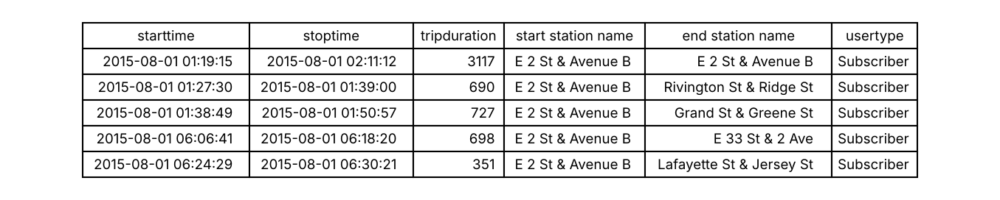
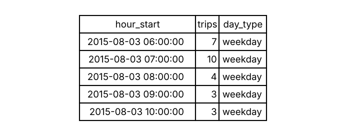

# Hourly Citi Bike demand at E 2 St & Avenue B

Example project for URP 6295: Urban Data Structure Basics.

## 1. Urban question
How many bike-share trips start at one Manhattan Citi Bike station in each hour, and how does this differ between weekdays and weekends? The answer can tell the operator when the station needs bikes restocked.

## 2. Data
- **Source:** [Citi Bike System Data](https://citibikenyc.com/system-data), August 2015. The subset used here (trips that started at station 301, E 2 St & Avenue B) comes from [introduction_to_ml_with_python](https://github.com/amueller/introduction_to_ml_with_python/blob/master/data/citibike.csv).
- **Size:** 4,212 trips, 15 columns, Aug 1-31, 2015. Stored in `data/citibike.csv`.

## 3. Input and output
**Input**
- **Data structure:** tabular
- **Description:** one row per trip, with start time, end time, duration, start and end stations, and user type (4,212 rows, 15 columns)
- **File:** `data/citibike.csv`



**Output**
- **Data structure:** time series
- **Description:** one row per hour of August 2015, with the number of trips that started in that hour and whether the hour is on a weekday or a weekend (744 rows)
- **File:** `data/hourly_trips.csv` (to be created)



## 4. Data loading code
`analysis.ipynb` loads the input data with Pandas:
```python
import pandas as pd

trips = pd.read_csv('data/citibike.csv', parse_dates=['starttime', 'stoptime'])
print(trips.shape)  # (rows, columns)
trips.head()
```

## 5. Plan
**Next steps**
- Round each trip's start time down to the hour and count trips per hour.
- Add the hours with no trips as 0, so every hour of August appears once.
- Add a `day_type` column (weekday or weekend).
- Save the result as `data/hourly_trips.csv`.

**How I will check the output**
- 31 days x 24 hours = 744 rows.
- The hourly counts must add up to the number of trips in the input (4,212).
- Count the trips for one hour by hand (e.g., Aug 3, 7:00-8:00) and compare with the output.
